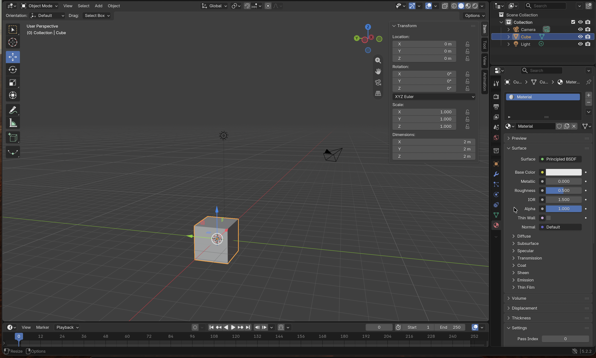

# BLENDER-NOTES (Assignment 3)

Blender 5.2.2 LTS on macOS. "Learn the window" session done by Shriram on 2026-10-14, before any prompting.
**The six notes below are Shriram's own words.** At Shriram's request, Claude made three small edits:
it removed an unverified shortcut ("command T"), and added the Dimensions reading and the Material tab, both visible in the screenshot below.
Reference: the Blender manual's interface chapter and 3D Viewport pages.

*Screenshot taken by Shriram (Cmd+Shift+4) of their own Blender session.*

1. **3D Viewport:** i was able to interact with it properly, i was able to drag using 2 fingers on the trackpad and look around the cube, which i think is called orbit, I was able to zoom in and out properly using the scroll on the mouse or by pinching the trackpad inward and outward, i held onto shift and i did the two-finger drag which i think made me look at all the objects on the scene which is called pan here, and i pressed the x-y-z (also -x, -y, -z) to look at the cube which is the main object on this viewport from different perspectives.
2. **Toolbar:** the toolbar in the left has a lot of functions like the move tool which helps me move the cube to different co-ordinates, the rotate tool helps me to rotate the object from the same position, scale tool helps me to resize the object in all 3 axis, clicking on the transform tool is the best while working as it is a combination of grabbing, rotation and scale all at once, add cube just goes ahead and adds another cube which i can place wherever i want, annotate tool helps me to draw or just note down stuff wherever i want like on the cubes or just on the 3d viewport, measure can be used to measure the distance between any given things, so here i added another cube and measured the distance between that and also used it to measure the distance between the cube and the light.
3. **Outliner:** for now i was able to use it to hide objects as i could see the camera, light and cube, and i was able to press the eye button to hide it
4. **Properties editor:** the properties editor had a lot of stuff, but mainly i noticed the location, rotation and scale which i can modify here to what i want for my particular assignment or project. it also has a column of tabs down its left side, and the red ball tab is the material tab, where the cube's material (Principled BSDF) and its base colour are set, which is where i'll set the colours for my assets.
5. **Sidebar (N):** the sidebar pops up when i press N, and it is much easier to access the item's transform properties from there, and also has a bunch of view properties, tool properties and animation properties kinda like a shortcut and that disappears when we press N again. it also shows the Dimensions, and the default cube is 2 m × 2 m × 2 m, which is how i'll check my assets are the size my brief says.
6. **Mode selector (Object / Edit Mode):** so i am able to switch between 2 modes, so i think the object mode is the default mode and when i press tab, it goes to the edit mode which helps me to see the points and edges and i am able to switch back to object mode using Tab again
